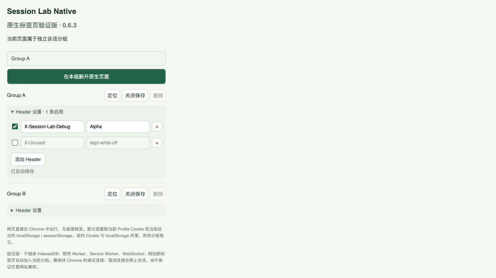

# SessionLab

在同一个 Chrome 浏览器中，为同一网站管理多个账号。每个 Session 对应一个标签页分组：创建时继承当前登录状态，之后同组标签共享会话，各组分别管理。

扩展中显示名称为 **Session Lab Native**，仓库源码为 **1.0.1 商店候选版**，稳定下载仍为 **1.0.0**。无需 Python 后台或本地服务；采用 Manifest V3，网页直接在 Chrome 原生标签页中运行。

## Chrome Web Store 上架准备

1.0.1 新增主密码加密保存和重启解锁，正在准备商店发行，**尚未在商店上架**。上传包、图标、真实截图、文案、权限理由和审核说明见 [商店材料](store/README.md)；数据处理见 [隐私说明](PRIVACY.md)。商店新签名 ID 不保证与旧手工加载扩展相同，已有分组不会自动跨 ID 迁移。

## 下载与安装

- [下载 v1.0.0 插件安装包](https://github.com/mactawishHui/SessionLab/releases/download/v1.0.0/session-lab-1.0.0.zip)
- [查看所有 Release](https://github.com/mactawishHui/SessionLab/releases)
- 仓库也保留同一份原始安装包：[dist/session-lab-1.0.0.zip](dist/session-lab-1.0.0.zip)，校验值见 [dist/SHA256SUMS.txt](dist/SHA256SUMS.txt)。

1. 下载并解压安装包到长期保留的目录，或克隆本仓库。
2. 打开 `chrome://extensions`，开启右上角的“开发者模式”。
3. 点击“加载已解压的扩展程序”，选择包含 `manifest.json` 的 `extension/` 文件夹。安装包中位于 `Session-Lab-1.0.0/extension/`。
4. 将 **Session Lab Native** 固定到工具栏。

ZIP 需要先解压，本项目尚未发布到 Chrome Web Store。完整步骤和保留现有会话的升级方式见 [INSTALL.md](INSTALL.md)。**升级前请先“关闭保存”受管分组，覆盖原加载目录后重新加载；不要卸载扩展或清除扩展存储。**

## 使用方式

1. 在普通标签页登录目标网站，打开扩展，填写分组名称，点击“新建分组 · 继承当前登录”。
2. 为同一网站创建多个分组，在各组内切换不同账号。同组共享会话，其他分组与普通标签各自独立。
3. 在组内通过扩展“在本组新开原生页面”；网站登录流程新开的页面也会自动归入来源组。
4. 可为各组分别配置自定义 Header，每条独立启用，修改自动保存。
5. 点击“关闭保存”保存并关闭分组，下次通过“打开”恢复，或通过“定位”切换到已打开的分组。

新建时复制 Cookie 和当前网站的 localStorage/sessionStorage 快照；恢复已有分组时使用其保存状态。同组 Cookie 与 localStorage 共享更新，sessionStorage 按页面生命周期管理。

## 权限、数据与兼容性

- 使用 `debugger` 接管受管标签的网络请求，使用 Cookie、存储、标签页、标签分组、脚本和网络规则权限实现会话管理。需要访问 HTTP/HTTPS 网站；完整权限见 [manifest.json](extension/manifest.json)。
- 1.0.1 的保存会话经主密码加密保存在本机扩展存储中；1.0.0 原包尚无该保护。请勿分享扩展存储或 Chrome Profile；仓库及安装包不携带用户会话。
- 需要保持 Chrome 的调试连接，不要取消“正在调试此浏览器”提示；断开后需通过扩展重新打开分组。
- Manifest 声明最低 Chrome 125；原项目提供的验收记录使用 Chrome 155.0.8059.85，最低版本声明不等于完整兼容性保证。
- 不继承原 Profile 的 IndexedDB；禁用 Worker、Service Worker、WebSocket。部分窗口通信、登录流程、流式响应及大文件可能不兼容。
- 普通 GET/HEAD API 会使用内部范围条件 Header 避免共享 HTTP 缓存，可能与某些网关或请求签名方案冲突。显式 Range 请求及静态合成响应在 DevTools Keep log 下不保证显示正文。
- 这是浏览器 API 层的会话隔离方案，并非浏览器内核安全容器；服务端主动撤销共享会话时，相关副本也可能一起失效。

完整边界见 [安装说明](INSTALL.md)与[架构说明](docs/ARCHITECTURE.md)。

## 源码与打包

```text
extension/          可直接加载的扩展源码
checks/             虚构站点测试、历史测试记录与演示截图
docs/               架构、维护与打包验证说明
scripts/package.py  使用 Python 标准库生成安装 ZIP
dist/               原始 1.0.0 安装 ZIP 与 SHA-256
INSTALL.md          安装、升级与日常操作
RELEASE-NOTES.md    原版本发布说明
```

运行不需要 npm install 或编译。1.0.1 首次运行需设置至少 12 字符的主密码并确认披露；浏览器重启或扩展重新加载后需解锁。密码无法找回。修改源码后在扩展管理页重新加载。重新生成安装包：

```sh
python3 scripts/package.py
```

输出为 `dist/session-lab-1.0.1-rebuilt.zip`，保留原始安装包；使用固定时间戳以便重复打包校验。重新打包后的 ZIP 字节与原包可能不同，内含扩展文件应与当前源码一致。原扩展公钥和 ID `bahdeeelkjdmmphobgajdepfdpmcfade` 保持不变。

## 验证与文档

原项目附带的 42 项检查历史报告保留原样；1.0.1 在 Chrome 156 上重新通过同一组 42 项回归，并通过新增 14 项主密码浏览器检查和 19 项 Node 检查，详见[商店材料](store/README.md)。首次导入检查范围见 [仓库发布核验](docs/PUBLISHING.md)。开发环境及测试运行方式见 [维护文档](docs/MAINTENANCE.md)。

- [原版发布说明](RELEASE-NOTES.md)
- [DevTools 修复说明](checks/devtools-fix.md)
- [历史检查汇总](checks/devtools-fix-result.json)
- [首次加载性能样本](checks/cold-start-performance.md)与[缓存性能样本](checks/performance.md)

以下为原项目的虚构账号演示截图，界面版本可能早于 1.0.0：



## 许可

当前未指定开源许可证。仓库公开供查看，使用、修改与再分发的授权以项目所有者后续明确的许可为准。
